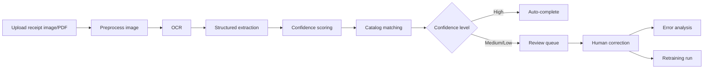
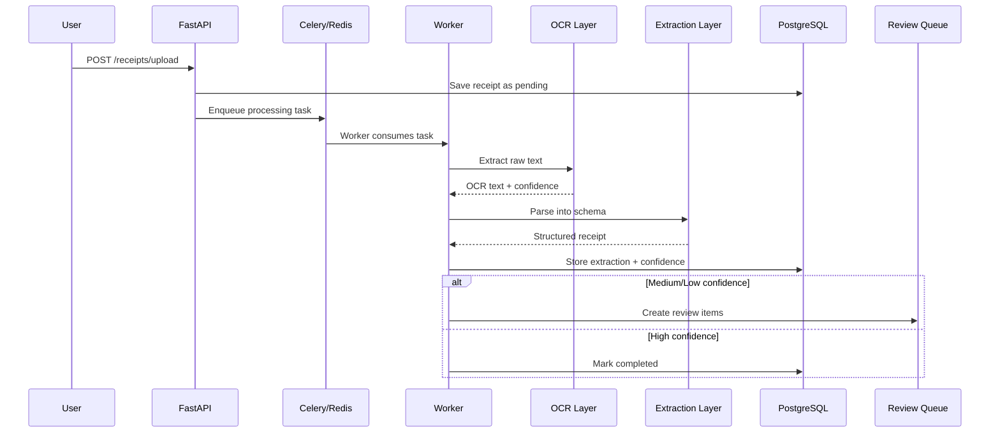

## Introduction

Automating receipt processing looks simple until it meets real-world data: low-light photos, skewed scans, inconsistent layouts, abbreviations, missing fields, and vendor-specific formatting.  
The Receipt Intelligence Pipeline was built to solve that exact gap between demo-friendly AI and production-grade document processing.

At a high level, the platform ingests a receipt image or PDF, extracts raw text, converts that text into structured fields, evaluates confidence, and routes uncertain outputs for human correction. Over time, those corrections become learning signal that improves the system.

This design intentionally prioritizes reliability, auditability, and continuous improvement over one-shot automation claims.

## Problem statement and design goals

This project focuses on four practical goals:

1. **Extract structured receipt data from noisy documents** with predictable schemas.
2. **Scale processing asynchronously** so uploads remain responsive under load.
3. **Protect data quality with confidence-aware review**, not blind auto-acceptance.
4. **Create a feedback loop** where corrections drive measurable model improvement.

These goals shape every architectural decision in the system.

## System architecture



```text
Upload -> OCR -> Structured Parse -> Confidence -> Match -> Store
                                          |
                                          +-> High confidence   -> Auto-complete
                                          +-> Medium confidence -> Field review
                                          +-> Low confidence    -> Full review
```

### Main building blocks

- **FastAPI**: ingestion and operational APIs
- **Celery + Redis**: background orchestration for asynchronous document processing
- **PostgreSQL + pgvector**: transactional data + semantic matching
- **OCR layer**: AWS Textract (primary) with Tesseract fallback
- **Extraction layer**: schema-constrained LLM parsing with backend flexibility

## Execution lifecycle of a single receipt



From a product perspective, this means users get immediate upload acknowledgment while heavy processing happens in the background and final states are persisted for later retrieval.

## Core concepts and how they are implemented

### 1) Asynchronous first architecture

Receipt parsing is compute-heavy and variable in duration.  
Instead of blocking request/response cycles, the API writes a receipt record and dispatches a worker task.

Benefits:
- stable API responsiveness,
- horizontal worker scaling,
- improved fault isolation (worker failure does not crash API runtime).

### 2) Hybrid OCR for resilience

OCR quality determines everything downstream. The pipeline uses a layered strategy:

- try **Textract** when cloud credentials are configured,
- fall back to **Tesseract** if Textract is unavailable or fails.

This avoids a single dependency bottleneck and lets the system run in both cloud-enabled and local-only environments.

### 3) Structured extraction instead of free text

Raw OCR text is passed to an extraction layer that must return a strict schema (`Receipt`, `LineItem`), validated by Pydantic.

Supported modes:
- `openai` for structured extraction through OpenAI models,
- `groq` using an OpenAI-compatible endpoint with normalization safeguards,
- `heuristic` as a local baseline path with zero API cost.

This multi-mode design is useful for cost control, provider flexibility, and benchmark reproducibility.

### 4) Confidence as a control mechanism

The system computes an overall confidence score using OCR confidence and extraction consistency checks.  
It then routes records by confidence level:

- **High** confidence: complete automatically
- **Medium** confidence: targeted review tasks
- **Low** confidence: full manual review

This is the most important quality mechanism in the project: confidence is not just metadata; it controls workflow behavior.

### 5) Product normalization and semantic matching

Line items from receipts are inherently noisy (`MILK 2%`, `MILK2PCT`, `MK 2%`).  
The matching layer standardizes these using:

1. fuzzy matching for fast wins,
2. embedding similarity via pgvector when fuzzy confidence is insufficient.

The result is better downstream analytics and cleaner product-level reporting.

### 6) Human feedback loop and retraining

Corrections submitted in review are stored as first-class data, then analyzed for recurring error types.  
Scheduled and on-demand retraining jobs use this signal to create new model iterations and track improvements over time.

In practice, this turns manual review from a cost center into an optimization loop.

## Data model and traceability

The database is organized so every pipeline stage is auditable:

- **Receipts**: lifecycle status, OCR provider, confidence, totals, timestamps
- **Line Items**: parsed item-level details + matching metadata
- **Review Queue**: pending and resolved corrections with notes
- **Canonical Products**: normalized catalog entries (with optional embeddings)
- **Retraining Runs**: trigger source, sample counts, validation metrics

This model makes it easier to answer operational questions such as:
- Where is quality dropping?
- Which fields trigger most corrections?
- Did retraining improve the right metrics?

## Operational API surface

The system exposes endpoint groups for each operational concern:

- **Ingestion and retrieval**: upload, batch status, receipt detail, OCR text
- **Review operations**: queue listing, approve/correct/skip actions
- **Catalog services**: product lookup and matching endpoints
- **Analytics services**: error patterns, calibration, estimated cost views
- **Retraining control**: trigger and run history endpoints
- **System checks**: health and Prometheus metrics

This separation keeps integrations simple for product teams and maintainable for backend teams.

## Benchmarking methodology and findings

The repository includes a benchmark runner for CORD (`benchmarks/run_cord.py`) and report generation tooling.

### Extraction backends under test

- `heuristic` (no API dependency)
- `openai` (structured LLM extraction)
- `groq` (OpenAI-compatible structured extraction)

### 50-sample Groq run: baseline vs tuned configuration

```text
Success rate          86%   -> 90%
Total exact match     30.2% -> 44.4%
Line-item price exact 22.6% -> 34.4%
Line-item name fuzzy  40.9% -> 36.7%
Avg latency           5.07s -> 23.73s
```

```text
Visual trend (higher is better except latency)

Success rate          baseline ██████████████████ 86%
                      tuned    ███████████████████ 90%

Total exact match     baseline ██████ 30.2%
                      tuned    █████████ 44.4%

Line-item price       baseline ████ 22.6%
                      tuned    ███████ 34.4%

Line-item name fuzzy  baseline ████████ 40.9%
                      tuned    ███████ 36.7%
```

Interpretation:
- tuning materially improved numeric extraction reliability,
- reliability improved slightly overall,
- latency increased significantly,
- item-name fuzzy quality still needs targeted optimization.

This is a realistic production tradeoff profile: better accuracy often increases compute latency and cost.

## Engineering tradeoffs and lessons

### Why this architecture works

- Confidence-driven routing prevents low-quality auto-finalization.
- Asynchronous workers make the system scalable and responsive.
- Multi-provider extraction reduces vendor lock-in risk.
- Structured schemas reduce silent data corruption from free-form text.

### Current limitations

- OCR quality still constrains extraction ceiling for heavily degraded documents.
- Some tuned modes improve accuracy but increase latency.
- Catalog quality depends on how complete canonical product seed data is.

### Next improvements

- stronger line-item name normalization and domain dictionaries,
- adaptive model routing based on receipt complexity,
- richer benchmark slices by document quality category,
- stricter automated regression checks for extraction metrics.

## References and further reading

### Project repository
- [Receipt Intelligence Pipeline (GitHub)](https://github.com/theSelfSa/receipt-intelligence-pipeline)

### Important implementation files
- [Pipeline orchestration](https://github.com/theSelfSa/receipt-intelligence-pipeline/blob/main/app/services/pipeline.py)
- [OCR service (Textract + Tesseract)](https://github.com/theSelfSa/receipt-intelligence-pipeline/blob/main/app/services/ocr.py)
- [Structured extraction service](https://github.com/theSelfSa/receipt-intelligence-pipeline/blob/main/app/services/extraction.py)
- [Benchmark runner](https://github.com/theSelfSa/receipt-intelligence-pipeline/blob/main/benchmarks/run_cord.py)
- [Celery worker + scheduler config](https://github.com/theSelfSa/receipt-intelligence-pipeline/blob/main/app/worker.py)
- [API routers](https://github.com/theSelfSa/receipt-intelligence-pipeline/tree/main/app/routers)

### Technology documentation
- [FastAPI](https://fastapi.tiangolo.com/)
- [Celery](https://docs.celeryq.dev/en/stable/)
- [Redis](https://redis.io/docs/)
- [PostgreSQL](https://www.postgresql.org/docs/)
- [pgvector](https://github.com/pgvector/pgvector)
- [Tesseract OCR](https://github.com/tesseract-ocr/tesseract)
- [AWS Textract](https://docs.aws.amazon.com/textract/)
- [Pydantic](https://docs.pydantic.dev/)
