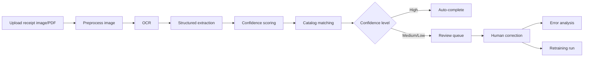
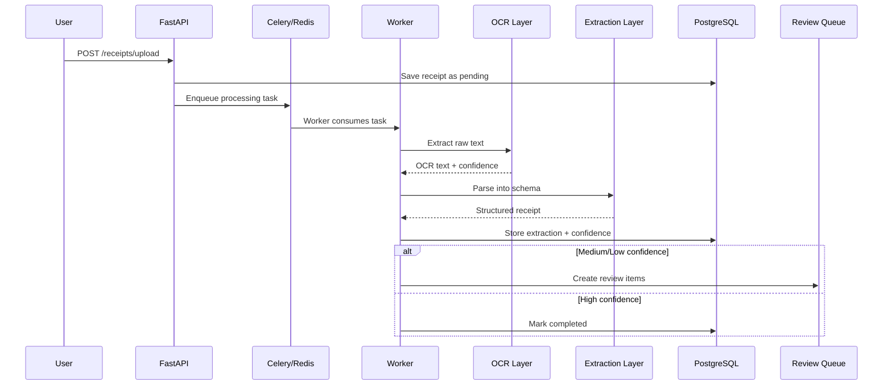

## What this project does (in plain English)

Most receipt tools fail when the image is blurry, the layout is unusual, or line items are messy.  
This project is built to handle that reality.

You upload a receipt image (or PDF), and the system:

1. reads text from the document using OCR,
2. converts it into structured fields (merchant, date, total, items),
3. scores how trustworthy the extraction is,
4. sends uncertain results to human review,
5. learns from corrections over time.

So instead of pretending AI is always correct, it combines automation **and** quality control.

## Why this matters

For business users: this reduces manual data entry and speeds up expense/accounting workflows.  
For engineering teams: this shows a production pattern for AI systems where reliability matters more than flashy demos.

## End-to-end architecture



```text
Upload -> OCR -> Structured Parse -> Confidence -> Match -> Store
                                          |
                                          +-> High confidence   -> Auto-complete
                                          +-> Medium confidence -> Field review
                                          +-> Low confidence    -> Full review
```

## How one receipt moves through the system



## Behind the scenes: implementation breakdown

### 1) API and asynchronous processing

The API accepts uploads quickly and delegates heavy work to background workers.  
This keeps user-facing response times fast while OCR/LLM tasks run asynchronously.

- API layer: FastAPI routes for upload, retrieval, review, analytics, and retraining.
- Queue layer: Celery workers + Redis broker.
- State layer: PostgreSQL stores receipt state, line items, review items, and retraining runs.

### 2) OCR strategy: cloud-first, local fallback

The OCR layer tries AWS Textract first, then falls back to Tesseract when needed.  
This balances accuracy with operational flexibility.

- If cloud credentials are available, Textract can improve extraction quality for complex docs.
- If cloud OCR fails (or is unavailable), local Tesseract still keeps the pipeline running.
- The service computes word-level confidence and an aggregate OCR confidence score.

### 3) Structured extraction (multiple modes)

The extraction output is validated against strict Pydantic schemas (`Receipt`, `LineItem`) to avoid free-form hallucinated text.

Supported extraction backends:

- **OpenAI mode** (structured extraction),
- **Groq mode** (OpenAI-compatible interface + normalization wrapper),
- **Heuristic mode** (fully local/no API mode for zero-cost benchmarking).

This is useful when you want either:
- strongest quality (paid API),
- lower cost experimentation,
- or completely offline sanity checks.

### 4) Confidence routing and human review

Every receipt receives an overall confidence score and level:

- **High** → auto-complete
- **Medium** → targeted review on uncertain fields
- **Low** → full review required

This design avoids a common AI mistake: blindly trusting uncertain predictions.

### 5) Catalog normalization

Line items are matched against a canonical product catalog:

1. fuzzy match first (fast + cheap),
2. embedding similarity (pgvector) as fallback when needed.

This helps normalize noisy item names into cleaner, consistent product records.

### 6) Learning loop (error analysis + retraining)

Human corrections are not just fixes; they become training signal:

- corrected fields are captured in the review pipeline,
- error patterns are analyzed (scheduled + on-demand),
- retraining runs can be triggered and tracked with run metadata.

In short: the system is designed to improve with usage.

## Data model in simple terms

Think of it as five core record types:

- **Receipts**: one row per uploaded document
- **Line Items**: child rows for extracted products/prices
- **Review Queue**: unresolved low-confidence or corrected fields
- **Canonical Products**: normalized product catalog for matching
- **Retraining Runs**: history of training/improvement attempts

This structure makes auditing and debugging much easier than storing everything as one big JSON blob.

## Benchmarking and measured outcomes

The project includes a CORD benchmark runner with report generation scripts.

### Modes used in benchmarking

- `heuristic` (local, no API cost)
- `openai` (paid API extraction)
- `groq` (paid/free-tier-compatible OpenAI-style extraction)

### Sample 50-receipt Groq comparison (baseline → tuned)

```text
Success rate          86%   -> 90%
Total exact match     30.2% -> 44.4%
Line-item price exact 22.6% -> 34.4%
Line-item name fuzzy  40.9% -> 36.7%
Avg latency           5.07s -> 23.73s
```

```text
Visual trend (higher is better except latency)

Success rate          baseline ██████████████████ 86%
                      tuned    ███████████████████ 90%

Total exact match     baseline ██████ 30.2%
                      tuned    █████████ 44.4%

Line-item price       baseline ████ 22.6%
                      tuned    ███████ 34.4%

Line-item name fuzzy  baseline ████████ 40.9%
                      tuned    ███████ 36.7%
```

Interpretation:
- tuning improved numeric extraction reliability,
- but increased latency,
- and item-name fuzzy matching still needs improvement.

This is realistic engineering tradeoff data, not cherry-picked perfect numbers.

## Practical tradeoffs and design choices

### Why confidence + review instead of “full automation”?
Because receipts are noisy in the real world. Controlled human review gives better business trust than false confidence.

### Why pgvector instead of adding a separate vector database?
For this scope, pgvector inside PostgreSQL keeps architecture simpler and operationally cheaper.

### Why keep a heuristic mode?
It gives a no-cost baseline and a fallback testing path when API keys, quotas, or budgets are limited.

## Who can use this system

- Teams building expense automation workflows
- Founders validating receipt intelligence MVPs
- Engineers learning how to productionize OCR + LLM pipelines
- Anyone who wants a reference architecture for “AI + human review” systems

## References and deep links

### Project repository
- [Receipt Intelligence Pipeline (GitHub)](https://github.com/theSelfSa/receipt-intelligence-pipeline)

### Key implementation files
- [Pipeline orchestration](https://github.com/theSelfSa/receipt-intelligence-pipeline/blob/main/app/services/pipeline.py)
- [OCR service (Textract + Tesseract)](https://github.com/theSelfSa/receipt-intelligence-pipeline/blob/main/app/services/ocr.py)
- [Structured extraction service](https://github.com/theSelfSa/receipt-intelligence-pipeline/blob/main/app/services/extraction.py)
- [Benchmark runner](https://github.com/theSelfSa/receipt-intelligence-pipeline/blob/main/benchmarks/run_cord.py)
- [Celery worker + schedules](https://github.com/theSelfSa/receipt-intelligence-pipeline/blob/main/app/worker.py)
- [API routers](https://github.com/theSelfSa/receipt-intelligence-pipeline/tree/main/app/routers)

### External technologies
- [FastAPI](https://fastapi.tiangolo.com/)
- [Celery](https://docs.celeryq.dev/en/stable/)
- [Redis](https://redis.io/docs/)
- [PostgreSQL](https://www.postgresql.org/docs/)
- [pgvector](https://github.com/pgvector/pgvector)
- [Tesseract OCR](https://github.com/tesseract-ocr/tesseract)
- [AWS Textract](https://docs.aws.amazon.com/textract/)
- [Pydantic](https://docs.pydantic.dev/)
